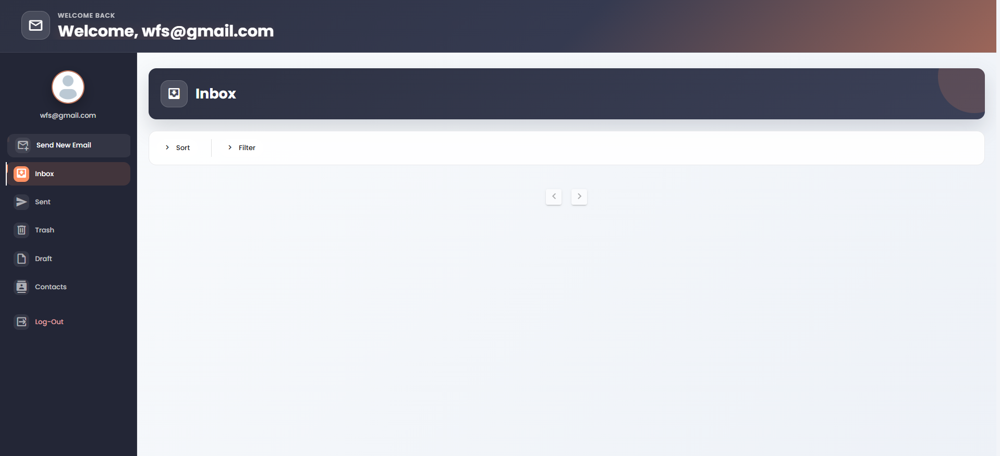
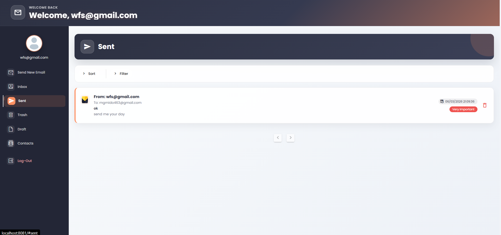
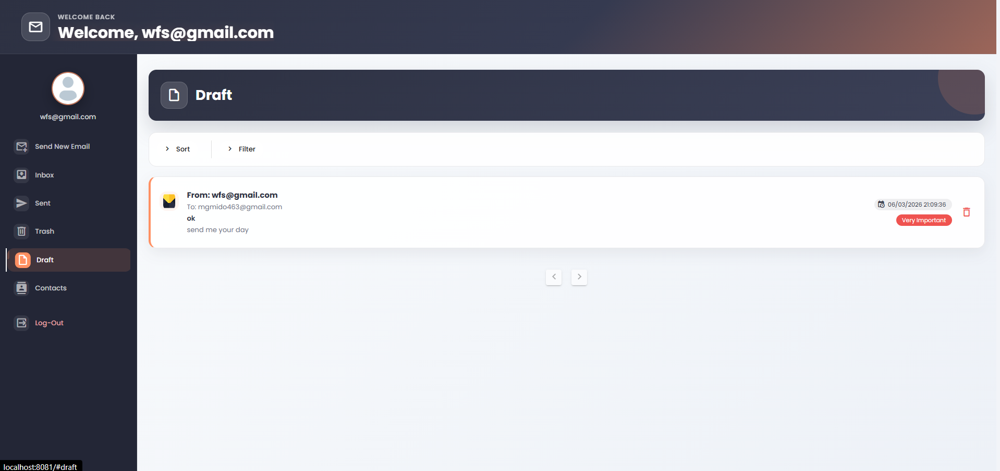
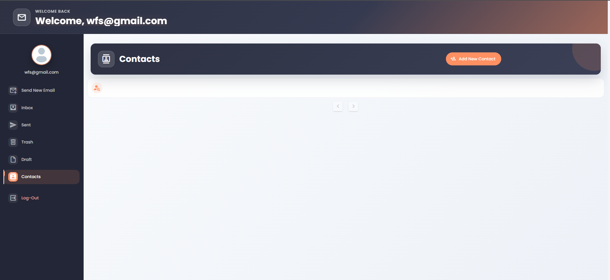
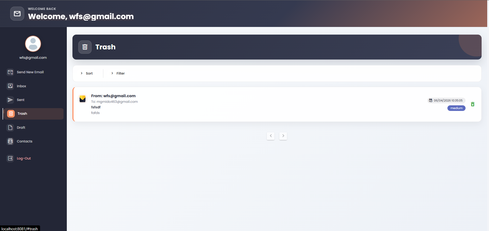

# 📬 MailSphere — Premium Mail Server Web Application

MailSphere is a sophisticated, feature-rich, full-stack email management system. It combines a robust **Spring Boot** backend leveraging GoF design patterns with a modern, glassmorphic **Vue.js** frontend built on **Vuetify** and polished with smooth animations and curated color palettes.

---

<div align="center">

[](https://spring.io/projects/spring-boot)
[](https://openjdk.org/)
[](https://vuejs.org/)
[](https://vuetifyjs.com/)
[](https://maven.apache.org/)

</div>

---

## 🖼️ Application Preview

Below are screenshots showing the application's clean, modern interface and various functionalities:

<table align="center" width="100%">
  <tr>
    <td align="center" width="50%">
      <b>🔒 Secure Authentication - Sign In</b><br>
      
    </td>
    <td align="center" width="50%">
      <b>📝 Secure Authentication - Sign Up</b><br>
      
    </td>
  </tr>
  <tr>
    <td align="center" width="50%">
      <b>📬 Interactive Inbox View</b><br>
      
    </td>
    <td align="center" width="50%">
      <b>✏️ Compose Email (Rich Dialog & Attachments)</b><br>
      
    </td>
  </tr>
  <tr>
    <td align="center" width="50%">
      <b>📤 Sent Emails Folder</b><br>
      
    </td>
    <td align="center" width="50%">
      <b>💾 Saved Drafts Manager</b><br>
      
    </td>
  </tr>
  <tr>
    <td align="center" width="50%">
      <b>👥 Contact Directory (Full CRUD)</b><br>
      
    </td>
    <td align="center" width="50%">
      <b>🗑️ Trash & Recovery Folder</b><br>
      
    </td>
  </tr>
</table>

---

## 🚀 Key Features

### 📧 Mail Management
*   **Compose & Send**: Send emails to multiple recipients simultaneously.
*   **File Attachments**: Support for uploading, sending, and previewing file attachments.
*   **Structured Folders**: Organizes mails into **Inbox, Sent, Drafts, and Trash**.
*   **Draft System**: Auto-save or manually store works-in-progress and resume editing later.
*   **Trash & Recovery**: Safe deletion mechanism allowing recovery of accidentally deleted emails.
*   **Bulk Operations**: Select multiple emails for bulk deletion or moving between folders.
*   **Priority Indexing**: Highlight/star important emails to keep them visible at the top.

### 👤 Contact Management
*   **Contact Directory**: Full CRUD system to create, update, and delete personal contacts.
*   **Multiple Emails per Contact**: Store and organize multiple email addresses for a single contact.
*   **Interactive Search & Filter**: Instantly search contacts or filter them by name, email, or other details.

### 🎨 Visual & Experience Polish
*   **Theme Integration**: A unified design system utilizing custom-tailored palettes (Orange-Coral accent, charcoal sidebar, and soft gradient backgrounds).
*   **Micro-interactions**: Smooth transitions between pages, hover states, modern dialogs, and customized webkit scrollbars.
*   **Typography**: Clean sans-serif experience using the Google Font **Poppins** for optimal UI readability.

---

## 🏗️ Architectural Design Patterns

The backend implements several **Gang of Four (GoF)** design patterns to establish high modularity, scalability, and code reuse:

1.  **Prototype Pattern**: Utilized to copy email templates and clone emails when distributing to multiple recipients or migrating messages between mail folders.
2.  **Adapter Pattern**: Connects pagination logic between user-facing requests (page numbers) and backend system structures (indices inside data records).
3.  **Iterator Pattern**: Provides a standardized iteration model to traverse across users, folders, and email list collections without exposing backend implementation details.
4.  **Proxy Pattern**: Enforces security and authorization validations on user profiles, folder actions, and CRUD operations.
5.  **Filter / Criteria Pattern**: Handles dynamic search, sorting, and multi-criteria filtering (by sender, date range, subject, status, or importance) via composite criteria components.
6.  **Facade Pattern**: Encapsulates multiple background services into a unified controller layer, presenting a clean API structure to Axios frontend clients.

---

## 💻 Tech Stack

### Frontend
*   **Framework**: Vue.js (v2.7)
*   **Styling & UI Components**: Vuetify (Material Design)
*   **State Management**: Vuex
*   **Routing**: Vue Router
*   **HTTP Communications**: Axios

### Backend
*   **Framework**: Spring Boot (v2.4.1)
*   **Language**: Java 11 (JDK 11)
*   **Build Automation**: Apache Maven
*   **Storage**: Lightweight JSON & File System persistence (no DB server required to run)

---

## 📂 Project Structure

```text
Mail-Server-WebApplication/
│
├── Back-end/                                # Java Spring Boot backend
│   └── eg.edu.alexu.csd.oop.email.cs231.../ # Main source package
│       ├── pom.xml                          # Maven configuration
│       ├── src/                             # Source code
│       └── users/                           # JSON storage database
│
├── Front-end/                               # Vue.js frontend SPA
│   ├── public/                              # HTML entry and icons
│   ├── src/
│   │   ├── App.vue                          # Main app component & styling
│   │   ├── main.js                          # Entry point
│   │   ├── components/                      # Reusable UI components
│   │   ├── views/                           # Main router page views
│   │   ├── router/                          # Page routes
│   │   └── store/                           # Vuex state store
│   └── package.json                         # Node dependencies
│
└── Screens/                                 # App screenshots gallery
```

---

## ⚙️ Installation & Running Locally

### Prerequisites
Make sure you have the following installed on your machine:
*   [Java Development Kit (JDK) 11](https://www.oracle.com/java/technologies/downloads/)
*   [Node.js (v14+) & npm](https://nodejs.org/)
*   [Apache Maven](https://maven.apache.org/)

### 1. Launch the Backend Server
Navigate to the backend package directory and run the Spring Boot server:

```bash
cd Back-end/eg.edu.alexu.csd.oop.email.cs231.thisisit.endone
mvn spring-boot:run
```
*The backend server will start on port `8080` (accessible at `http://localhost:8080`).*

### 2. Launch the Frontend Dev Server
In a new terminal, navigate to the frontend folder, install the Node packages, and run the development dev-server:

```bash
cd Front-end
npm install
npm run serve
```
*The frontend web application will spin up on port `8081` (accessible at `http://localhost:8081`).*

---

## 🔒 License
This project is developed as an educational project for Alexandria University, Computer Science and Automatic Control Department. All rights reserved.
